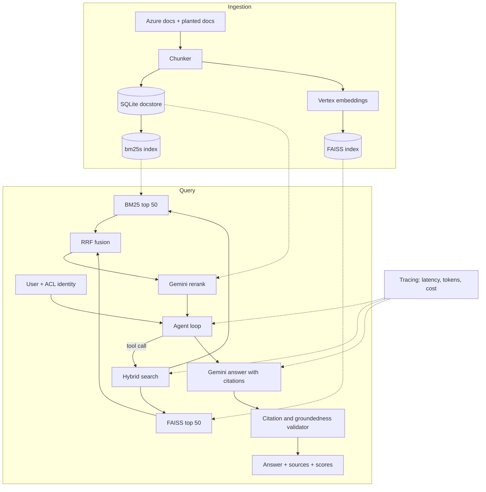
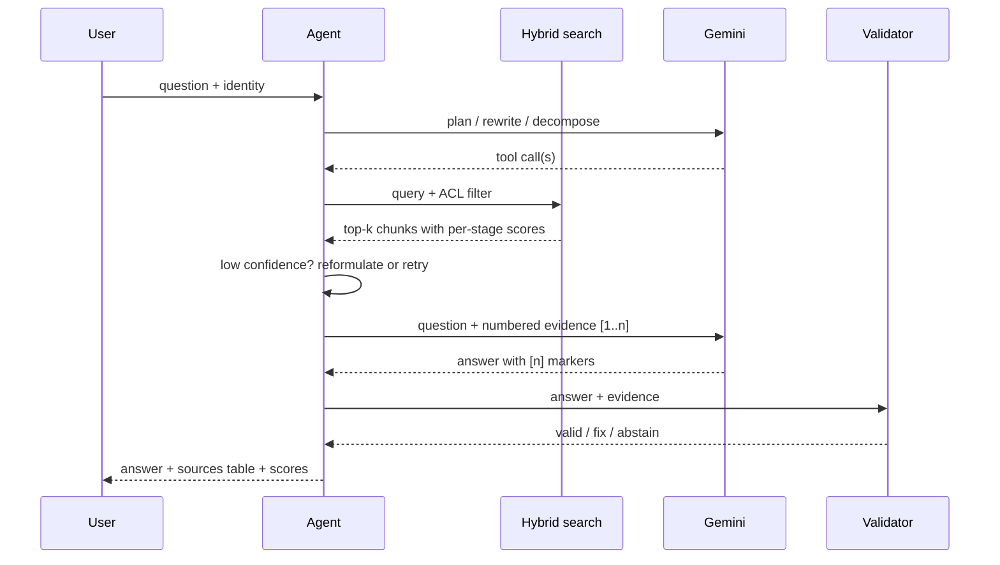

# Enterprise Agentic RAG with Hybrid Retrieval: POV Notebook Plan

## 1. Goal
A set of notebooks that demonstrates an enterprise-grade agentic RAG system. It combines BM25 lexical search, FAISS vector search, RRF fusion and a Gemini-based rerank. It returns answers with validated citations and scores, and it includes access control, tracing and evaluation.

The work is split into six notebooks in `notebooks/` that share the code in `rag_lib/`. The ingestion notebook writes the persisted store; every later notebook opens it read-only.

| Notebook | Purpose |
|---|---|
| `01_get_dataset` | Download the pinned Azure docs subset and write the synthetic documents |
| `02_ingestion` | Clean, chunk, embed and persist the document store, FAISS index, BM25 index and manifest |
| `03_retrieval` | BM25, vector, RRF and the Gemini reranker, access control, the golden set, retrieval evaluation and tuning sweeps |
| `04_simple_rag` | Baseline: vector search only, no validation |
| `05_hybrid_rag` | Hybrid retrieval, confidence gate, citation validation |
| `06_agentic_rag` | Tool-calling agent and the three-pipeline comparison |

Run them in order. The steps in section 4 map onto these notebooks.

## 2. Stack and decisions
| Area | Choice |
|---|---|
| LLM and embeddings | Vertex AI through `google-genai`, authenticated with gcloud Application Default Credentials |
| Lexical index | `bm25s`, a separate persisted index, with an identifier-aware tokenizer |
| Vector index | FAISS (`IndexIDMap2` over inner product on normalized vectors), separate and persisted |
| Document store | SQLite, the source of truth for documents, chunks, metadata and ACL |
| Fusion | Reciprocal Rank Fusion, $\text{score}(d)=\sum_r \frac{1}{k+\text{rank}_r(d)}$, with $k=60$ |
| Rerank | Gemini LLM reranker (single listwise call, structured JSON output with per-candidate scores) |
| Agent | Plain Python tool-calling loop using Gemini function calling |
| Corpus | Azure docs markdown subset (pinned commit) plus planted synthetic documents |

## 3. Architecture



### Query-time sequence



## 4. Step-by-step plan

### Phase 1: Foundation
1. **Setup and config.**
   - One config cell holds `PROJECT_ID`, `LOCATION`, `LLM_MODEL` and `EMBED_MODEL`, read from environment variables.
   - It checks credentials from `gcloud auth application-default login` and fails fast with a clear message.
   - An optional model-discovery cell probes which models respond.
   - It defines `Chunk`, `SearchHit` and `Trace` data structures.
2. **Corpus and ingestion.**
   - Fetch about 150-300 Azure docs articles from a pinned commit, plus 10-15 planted documents (restricted runbook, prompt-injection document, near-duplicates).
   - Chunk by heading with overlap. Record provenance: `doc_id`, `chunk_id`, title, heading path, source URL, character offsets and `content_hash`.
   - Assign synthetic ACL tags (`public`, `internal`, `restricted`).
   - Write documents and chunks to the SQLite store. Skip documents whose `content_hash` is unchanged.

### Phase 2: Indexes and persistence (steps 3 and 4 run in parallel)
3. **Vector index.**
   - Embed new chunks in batches with `RETRIEVAL_DOCUMENT`, with retry and backoff. Query embeddings use `RETRIEVAL_QUERY`.
   - L2-normalize and add to FAISS by `chunk_id`.
   - Chunks of changed or deleted documents are removed by ID first.
4. **Lexical index.**
   - Build a `bm25s` index from the document store with a custom tokenizer that keeps identifiers like `ERR_1234` and `--resource-group` intact.
   - Title boost by repeating title tokens. `k1` and `b` are tuned on the golden set.
   - ACL is applied at query time with a weight mask.
5. **Persistence.** Everything is saved under `store/`:
   ```
   store/
   ├── docstore.db      documents, chunks, ACL (source of truth)
   ├── bm25/            bm25s index and tokenizer config
   ├── faiss.index      FAISS index and id map
   └── manifest.json    models, dimension, chunker and tokenizer versions, counts
   ```
   On startup the notebook loads the store if it exists and rebuilds if the manifest does not match the current config.

### Phase 3: Retrieval
6. **Hybrid search.** ACL filter, then BM25 top 50 and FAISS top 50. Fuse with RRF. Each `SearchHit` keeps per-stage scores and ranks.
7. **Gemini rerank.** A `GeminiReranker` with `rerank(query, hits, top_k)` that reorders the RRF candidates (details in section 4a).
   - Take the RRF top ~30 (configurable), after ACL filtering, and keep the top 5-10.
   - One listwise call returns a relevance score from 0 to 10 for every candidate, as structured JSON.
   - Store the raw score and the normalized value (score / 10) on each `SearchHit`.
8. **Retrieval demo.** Queries where vector search fails (exact IDs), where lexical search fails (paraphrases), and where RRF plus rerank wins. A score-card table shows how each chunk moved through the stages.

### Phase 4: Agent and answer quality
9. **Agent loop.**
   - Gemini function calling with automatic calling off and a manual loop.
   - Tools: `lexical_search`, `vector_search`, `hybrid_search(filters)` and `get_document`.
   - Behaviors: query rewriting, decomposition for multi-hop questions, a retry when top reranker confidence is low, a step budget and a stop condition.
10. **Citations.**
    - Evidence goes to the model as numbered blocks `[1]...[n]`, one stable marker per unique chunk.
    - The model must cite every factual sentence with markers.
    - The validator checks that markers exist and are ACL-permitted, flags uncited claims, and runs a claim-level support check. Failures lead to regeneration or abstention.
    - The final output is the answer plus a sources table (marker, title, URL, heading, snippet, rerank score, normalized confidence, RRF/BM25/vector ranks).
11. **Guardrails.** ACL trimming before the LLM, prompt-injection test, refusal for unanswerable questions, and answer-confidence thresholds calibrated on the golden set.

### Phase 5: Enterprise-readiness
12. **Tracing.** A span decorator records step, tool, latency, tokens (from `usage_metadata`) and estimated cost. It is shown as a tree and a table.
13. **Evaluation.**
    - A golden set of about 30 questions, generated by Gemini from sampled chunks and reviewed by hand. Categories are exact-ID, paraphrase, multi-hop, ACL-denied and unanswerable.
    - Retrieval: recall@k, MRR, nDCG. Answer: LLM-as-judge correctness and groundedness. Citation: precision, recall, claim support rate, and invalid-marker rate.
14. **Comparison and takeaways.**
    - Compare BM25 only, vector only, RRF, RRF + Gemini rerank and agentic hybrid on quality, p50/p95 latency, tokens and cost.
    - Close with a production mapping (managed search, a real ACL source, OpenTelemetry).

### 4a. Gemini reranker design

**Why a second stage.** RRF merges ranks cheaply but never reads the query and the chunk together. The reranker does, so it fixes the ordering of the top results that the answering LLM sees.

**Approach: one listwise call.**
1. Input: the query and the RRF top ~30 candidates, each as `{id, title, heading, text}` with the text truncated to a fixed token budget.
2. The candidates are presented in a shuffled order (fixed seed), not in RRF order, so the model is not anchored on the incoming ranking.
3. Output: structured JSON (`response_schema`) with `[{id, score 0-10}]`, `temperature=0`. A short optional `reason` field is available for demos, at the cost of extra tokens.
4. Rubric in the prompt: 0 = unrelated, 3 = same topic only, 6 = partially answers, 9-10 = directly and completely answers. An explicit rubric keeps scores comparable across queries.
5. Sort by score, break ties by RRF rank, and keep the top 5-10.

**Safeguards**
- **Output validation:** every returned `id` must exist in the candidate set. Missing candidates get a fallback score derived from the RRF rank, and malformed JSON triggers one retry and then falls back to the RRF order. The pipeline never fails because of the reranker.
- **Prompt injection:** chunk text is wrapped in delimiters and the prompt states that it is untrusted data and must not be followed as instructions. The planted injection document tests this.
- **ACL:** only ACL-permitted chunks are sent to the reranker.
- **Model choice:** a fast Gemini model (Flash class) chosen through the model-discovery cell, pinned in the manifest.

**Scores and confidence.** The raw score and the normalized value (score / 10) are stored on each `SearchHit` next to the BM25, vector and RRF scores. The top score and the gap between the first and second candidate feed the agent's low-confidence retry.

**Trade-offs, to be documented in the notebook**
| | Gemini reranker | Local cross-encoder |
|---|---|---|
| Setup | Nothing extra to install | Needs `sentence-transformers` and `torch`, plus a model download |
| Quality | Strong on reasoning-heavy and technical queries | Strong and consistent, but trained on general web search data |
| Latency | Network call, roughly 1-3 s for ~30 candidates | Tens to hundreds of ms on CPU |
| Cost | Tokens per query (about 30 chunks of input) | Free at query time |
| Determinism | Near-deterministic at temperature 0 but can vary | Fully deterministic |
| Risks | Position bias, malformed output, prompt injection | Input length limit |

**Evaluation of the reranker**
- Compare RRF alone with RRF + Gemini rerank on recall@k, MRR and nDCG.
- Sweep the candidate pool size (10, 20, 30, 50) to show the quality, latency and token cost trade-off.
- Measure rank stability across repeated runs, and the effect of shuffled versus RRF-ordered input on position bias.
- Report p50 and p95 latency and tokens from `usage_metadata`.

**How the notebook documents it.** The reranking section contains:
1. A markdown overview with the pipeline diagram and the reasoning above.
2. The rubric prompt and the JSON schema, shown as readable cells.
3. A worked example: a query with the RRF order next to the reranked order, a score-card table (BM25, vector, RRF, rerank score), and the movement of each chunk.
4. The safeguards demonstrated: a malformed-output fallback, and the injected chunk being ignored.
5. The pool-size sweep and the trade-off table above, with the measured numbers filled in.

## 5. Dependencies
`google-genai`, `faiss-cpu`, `bm25s`, `numpy`, `pandas`, `tiktoken`. SQLite is in the standard library. No local model or `torch` is needed.

## 6. Verification
1. A clean kernel run from top to bottom.
2. Restart the kernel and reload the store with no re-embedding, and check that search results are identical.
3. Re-run ingestion with no changes and check that nothing is re-embedded.
4. Delete a document and check that it is gone from SQLite, BM25 and FAISS.
5. A restricted chunk ID never appears in the results or the trace for a low-privilege user.
6. The eval shows RRF >= the best single retriever on recall@k, and the reranker improves MRR and nDCG.
7. The invalid-marker rate is zero, and unanswerable questions are abstained rather than hallucinated.

## 7. Scope
- **In scope:** the notebook, the cached corpus and golden set, and the persisted store.
- **Out of scope:** large-scale ingestion pipelines, real authentication, a UI and fine-tuning.
- **Optional:** BEIR as a second benchmark, a local cross-encoder (`sentence-transformers`) as an offline reranker comparison, and `tantivy` or Elasticsearch for phrase and prefix queries.
