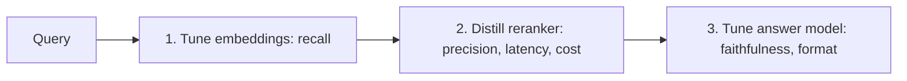

# Roadmap: Fine-tuning after the POV

The POV uses off-the-shelf components: Vertex AI embeddings, BM25, RRF, a Gemini reranker and a Gemini answer model. This roadmap lists the tuning steps to take once the evaluation shows a need. They are ordered by where errors originate in the pipeline, because an early error (the wrong chunks) cannot be fixed later (the answer model cannot use evidence it never received).

## Prerequisites (for every step)
- A labeled dataset of hundreds to thousands of queries with relevance labels. It can be bootstrapped with LLM-generated queries and then reviewed.
- A held-out evaluation set, to prove the gain and detect regressions.
- Versioned datasets and models, and a re-embed or rebuild procedure for the persisted store (the manifest flags a stale store).

## Step 1: Tune the embeddings (fix recall)

**Problem.** A general-purpose embedding model does not know the domain. It may place unrelated internal product names close together, or fail to link an employee's wording to the official article's wording. If the right chunk is not in the top 50 candidates, nothing downstream can recover it, so recall is the ceiling for the whole system.

**Action.** Train on (query, relevant chunk) pairs, with hard negatives mined from BM25 and FAISS results (chunks that look relevant but are not).

**Why first.**
- It has the highest leverage, since it raises the ceiling for every later stage.
- A change forces a full re-embed and FAISS rebuild, so it is cheapest to do before tuning other components against its output.

**Trigger.** Low recall@50 on paraphrase and jargon queries. BM25 already covers exact terms, so the gain is mostly on semantic queries.

**Done when.** Recall@50 and nDCG improve on the held-out set, with no regression on the exact-ID queries.

## Step 2: Distill the reranker (fix precision, latency and cost)

**Problem.** The Gemini reranker is accurate but takes seconds per query, costs tokens on every query, and is not fully deterministic.

**Action.**
1. Run Gemini offline over thousands of (query, candidate) pairs to produce relevance scores. This is a one-time cost.
2. Train a small cross-encoder to reproduce those scores.
3. Serve the small model at query time. It runs in milliseconds on CPU, has no per-query token cost, and is deterministic.
4. Keep Gemini as a fallback for low-confidence or high-value queries.

**Why second.**
- It must be trained on the candidate distribution produced by the tuned embeddings. Training earlier would learn from candidates that will change.
- Gemini acts as the teacher and labeler, so no human labels are needed.

**Trigger.** High recall but low MRR and nDCG, or rerank latency and cost too high at the expected volume.

**Done when.** The distilled model matches the Gemini reranker on MRR and nDCG within an agreed tolerance, at a fraction of the latency and cost.

## Step 3: Tune the answer model (fix faithfulness and format)

**Problem.** Even with perfect evidence, the model may cite incorrectly, go beyond the evidence, answer when it should abstain, or ignore the house style.

**Action.** Supervised tuning of Gemini on Vertex AI with examples of (question, evidence, ideal answer with valid citations, or an abstention). This teaches behaviour, not facts. Knowledge still comes from retrieval, so answers stay current and auditable.

**Why last.**
- Training examples are built from the retrieved and reranked chunks, so retrieval must be stable first.
- It is the most expensive step to run and maintain.
- Prompting plus the citation validator already gets most of the benefit.

**Trigger.** Good evidence, but the invalid-citation or unsupported-claim rate stays too high after prompt and validator improvements.

**Done when.** Invalid-marker rate stays at zero, the claim support rate and abstention accuracy improve on the held-out set, and no regression appears on retrieval-independent answer quality.

## Decision guide

| Eval symptom | Fix |
|---|---|
| Low recall@50 on paraphrase and jargon queries | Tune embeddings |
| High recall but low MRR/nDCG, or reranker latency and cost too high | Distill the reranker |
| Good evidence but high invalid-citation or unsupported-claim rate | Tune the answer model |

## Other options (not ordered)
- **Query understanding:** a small tuned model for query rewriting, decomposition and routing between lexical and semantic search, to cut agent steps and cost.
- **Lexical tuning:** BM25 `k1` and `b`, field boosts, synonym lists and the tokenizer, tuned on the labeled set. The POV already includes a small `k1`/`b` sweep.
